#  Hydrovel — Monitoramento Inteligente da Água

##  Sobre o projeto

O **Hydrovel** é um projeto de TCC voltado ao desenvolvimento de uma plataforma para monitoramento de sistemas hídricos residenciais, com foco na identificação de possíveis vazamentos e no acompanhamento de parâmetros de qualidade da água. A proposta integra tecnologias de Internet das Coisas (IoT), sensores e uma plataforma web para registrar, consultar e acompanhar informações relacionadas ao sistema hídrico.
**Importante:** os registros utilizados atualmente são dados de demonstração. A integração física com o ESP32 e os sensores ainda faz parte do desenvolvimento do projeto.

##  Objetivos

- Monitorar parâmetros relacionados à água.
- Registrar leituras recebidas pela plataforma.
- Apoiar a identificação de possíveis vazamentos.
- Disponibilizar histórico de leituras.
- Preparar a estrutura para futuras notificações e integração com dispositivos IoT.

##  Tecnologias utilizadas

- HTML
- CSS
- JavaScript
- Laravel Blade
- PHP
- Laravel 12
- Laravel Breeze para a estrutura de autenticação
- API REST para recebimento de leituras
- SQLite
- Migrations do Laravel
- Seeders para inserção de dados de demonstração

### Ferramentas
- Visual Studio Code
- Composer
- Node.js e npm
- Git e GitHub

##  Funcionalidades e estrutura

- Página de visualização de leituras dos sensores.
- Armazenamento de dados no banco SQLite.
- Endpoint para recebimento de leituras pela API.
- Validação dos dados recebidos.
- Proteção da API por chave de acesso.
- Dados de demonstração para testes e apresentação acadêmica.
- Laravel Breeze instalado para fornecer recursos de autenticação.

##  Banco de dados e Seeder

O projeto utiliza SQLite para armazenar as leituras. As migrations definem a estrutura das tabelas, enquanto os seeders permitem inserir registros de demonstração para testar e apresentar a aplicação. Para executar migrations em um ambiente de desenvolvimento configurado:

```bash
php artisan migrate
```

Para executar o seeder, confira primeiro a configuração em `database/seeders/DatabaseSeeder.php`. A execução pode adicionar novos registros de demonstração.

##  API de leituras

**Endpoint:** `POST /api/leituras`

A API recebe leituras dos sensores e valida os dados antes de armazená-los.

Parâmetros previstos:
- `pressao`
- `vazao`
- `ph`
- `turbidez`
- `temperatura`

A requisição utiliza o cabeçalho `X-API-KEY` para autenticação.

Respostas esperadas:
- `201`: leitura recebida e registrada.
- `401`: chave de acesso ausente ou inválida.
- `422`: dados inválidos.

### Configuração da chave

Configure `SENSOR_API_KEY` no arquivo `.env`. Não publique a chave real no GitHub.
O arquivo `.env.example` contém um valor ilustrativo para orientar a configuração.

##  Como executar o projeto

1. Instale PHP, Composer e as dependências necessárias do Laravel.
2. Clone este repositório.
3. Entre na pasta do projeto.
4. Instale as dependências:

```bash
composer install
npm install
```

5. Crie o arquivo de ambiente:

```bash
copy .env.example .env
```

6. Gere a chave da aplicação:

```bash
php artisan key:generate
```

7. Configure o banco SQLite e as variáveis de ambiente.
8. Execute as migrations:

```bash
php artisan migrate
```

9. Compile os arquivos do Front End:

```bash
npm run build
```

10. Inicie o servidor:

```bash
php artisan serve
```

Acesse o endereço informado pelo Laravel no terminal, normalmente `http://127.0.0.1:8000`.


## Evidências do desenvolvimento

As imagens a seguir apresentam registros do desenvolvimento e dos testes realizados na aplicação Hydrovel, incluindo a execução local, o banco de dados, o Front-End, o Back-End, as rotas e a proteção da API.

### 1. Aplicação e banco de dados

**01 — Aplicação executando em localhost**

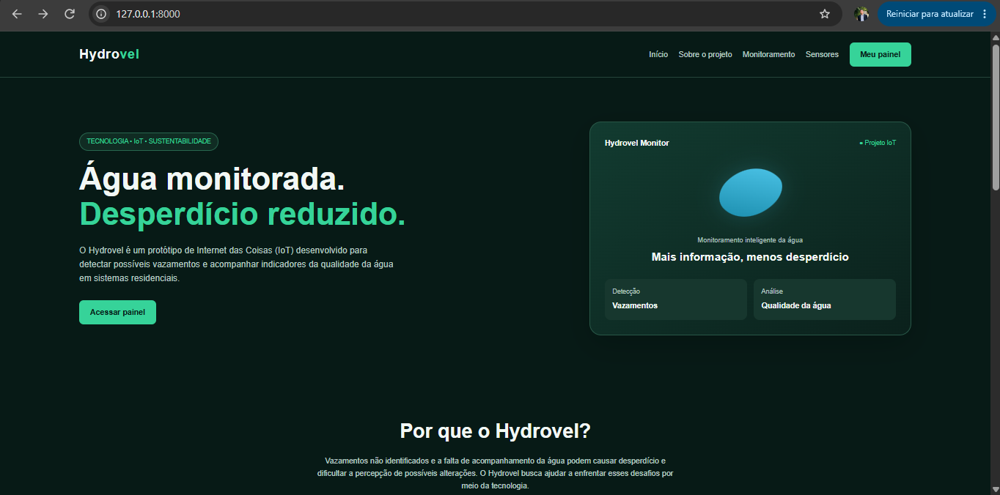

**02 — Migrations do banco de dados**

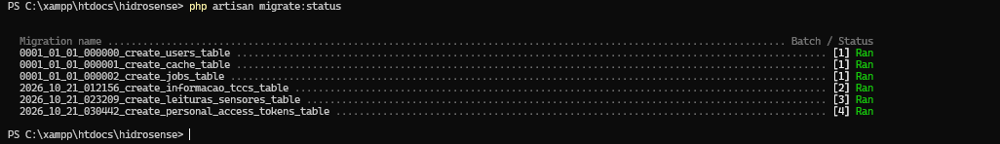

**03 — Seeder com dados de demonstração**

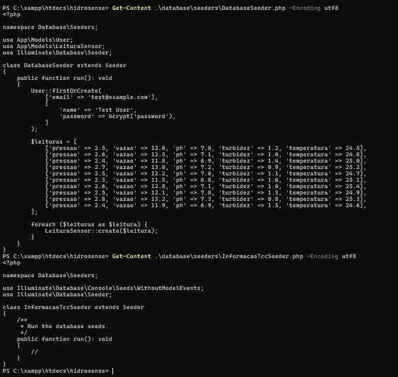

**04 — Registros armazenados no banco de dados**

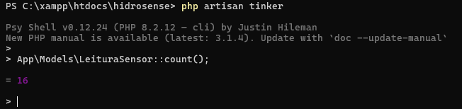

### 2. Front-End — CRUD de leituras

**05 — Listagem de leituras**

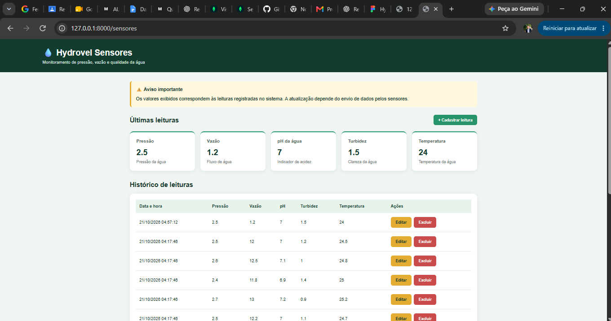

**06 — Cadastro de leitura**

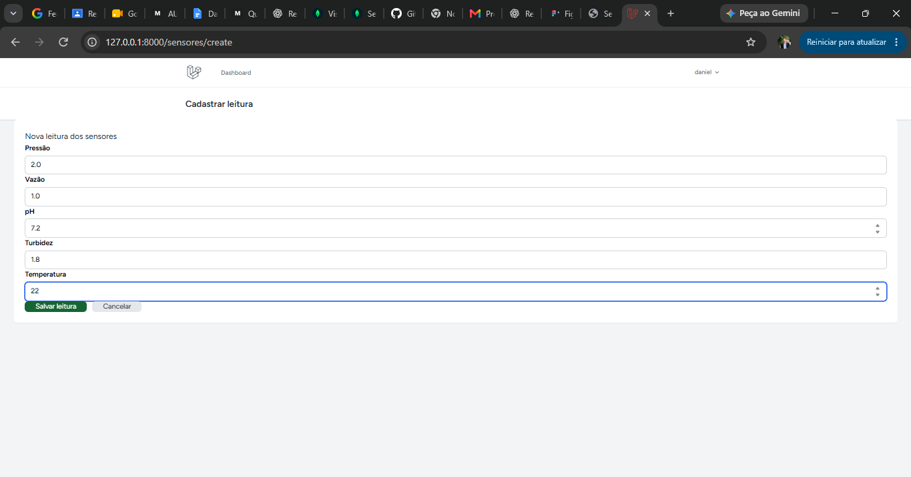

**07 — Edição de leitura**

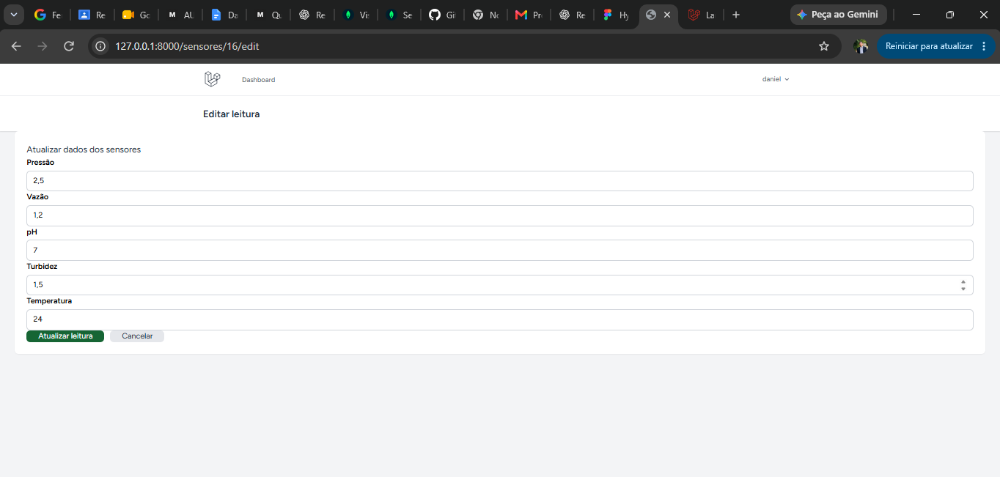

**08 — Confirmação de exclusão**

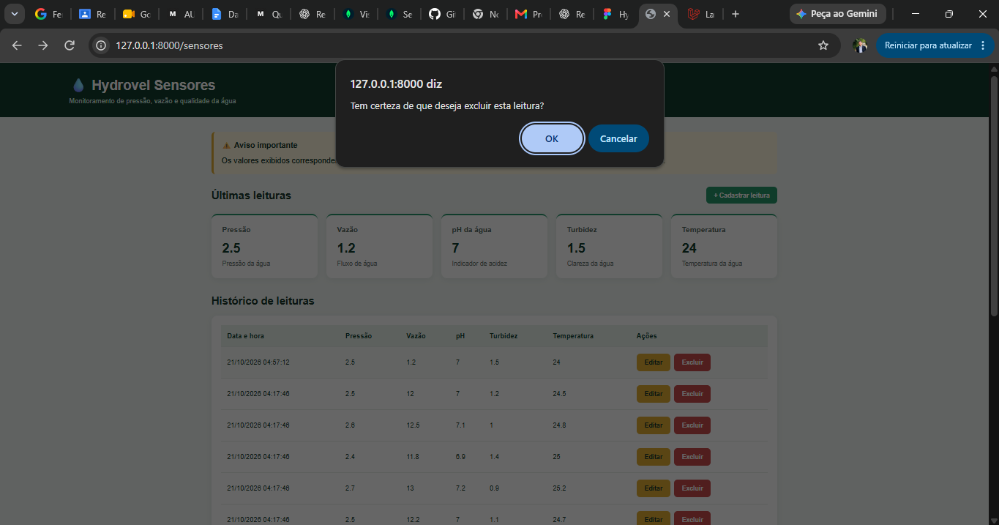

### 3. Back-End — Controller e operações CRUD

**09 a 13 — Implementação do Controller**

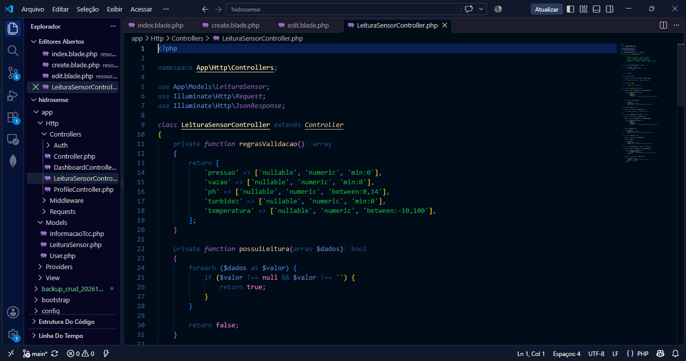

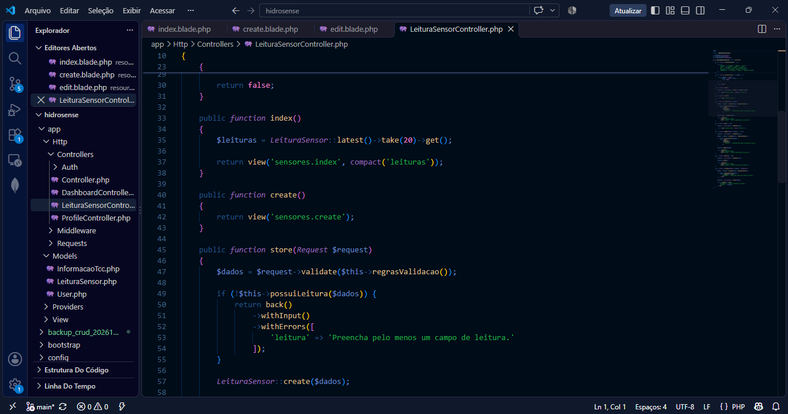

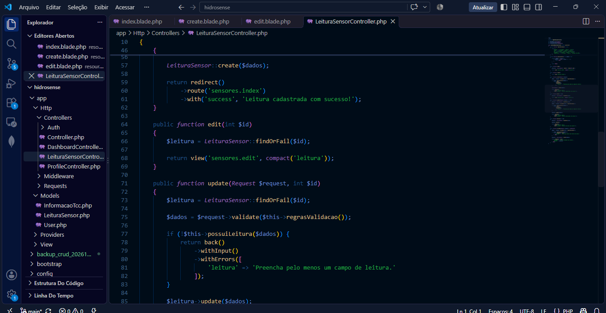

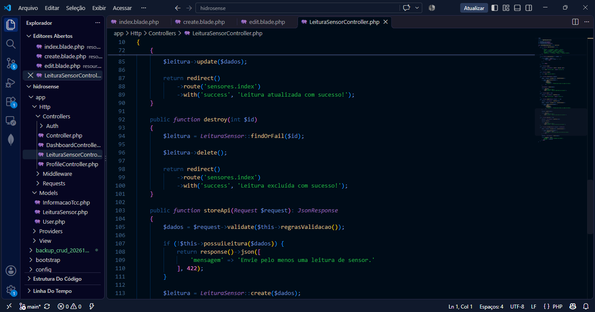

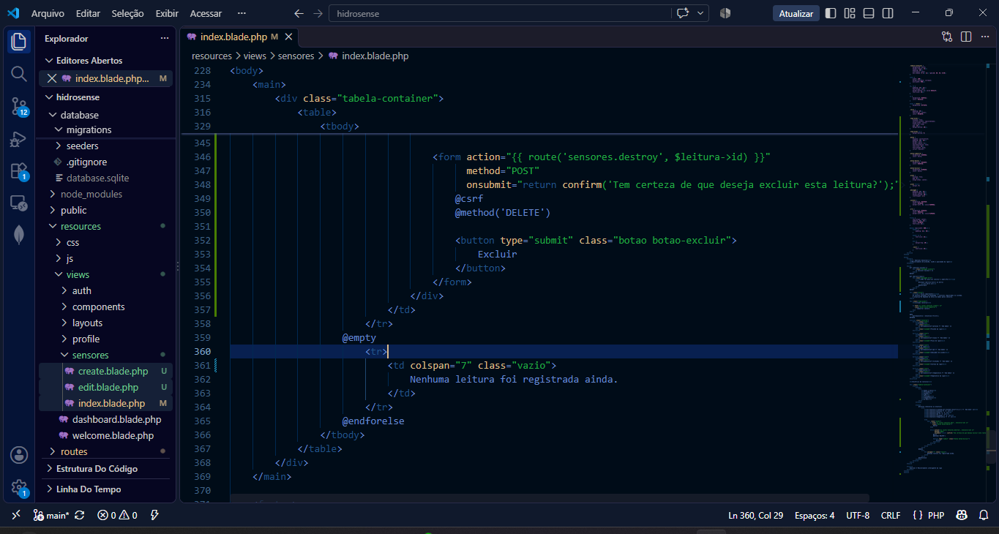

### 4. Back-End — Rotas e Middleware

**14 a 16 — Rotas do CRUD**

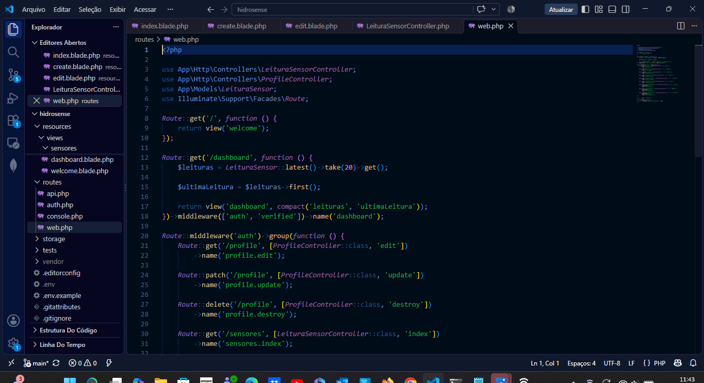

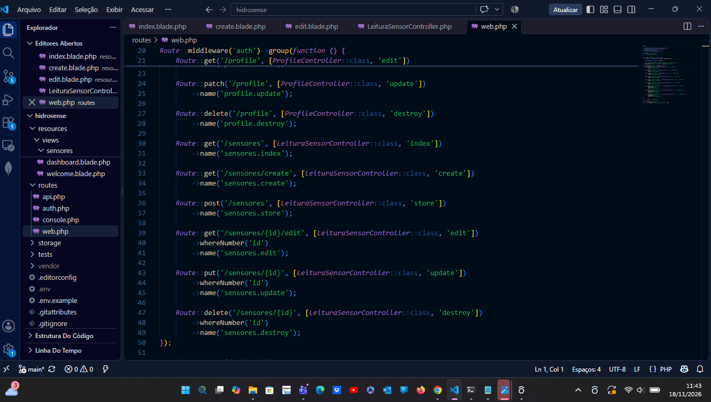

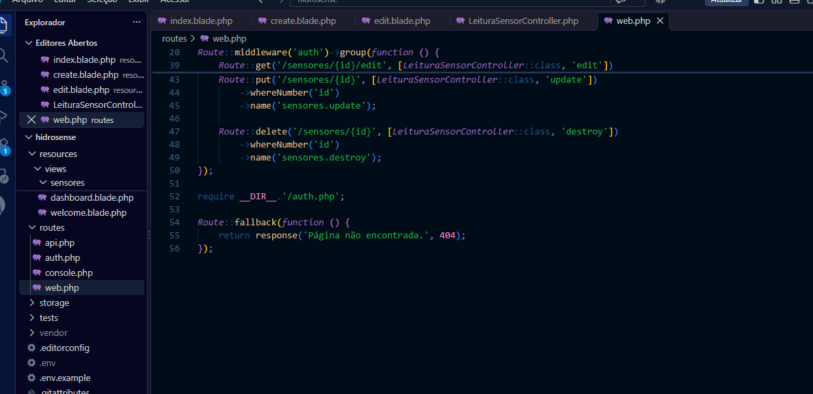

**17 — Rotas da API**

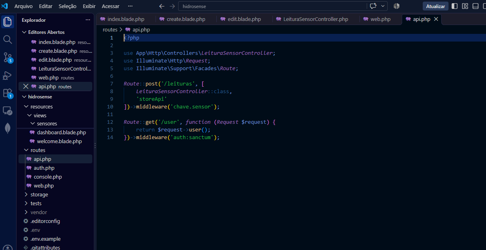

**18 — Middleware de proteção da API**

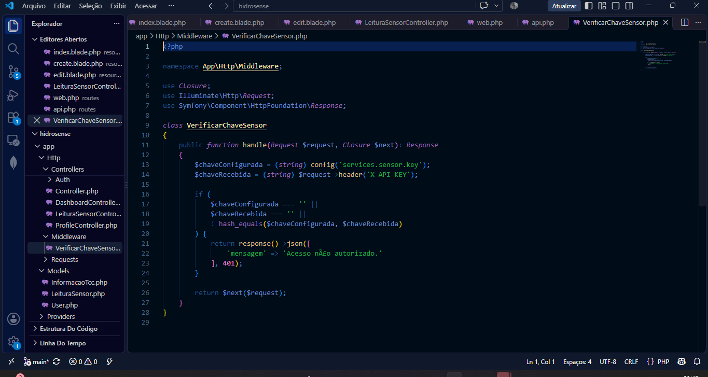

**19 — Registro do Middleware na aplicação**

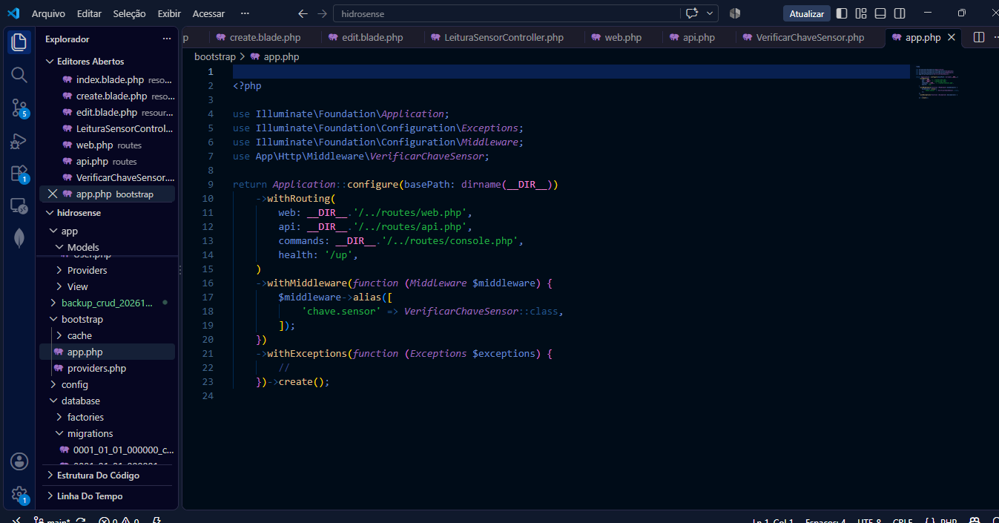

##  Protótipo no Figma

**Link:** https://www.figma.com/design/ACJ72LwKj2ZrKZ3DCSsRe4?node-id=.

##  Vídeo de apresentação

**Link do YouTube: https://youtu.be/5XqDDvTt2YY **

O vídeo deverá demonstrar o funcionamento do site, a autenticação, o banco de dados com os dados de demonstração e a contribuição dos integrantes.

##  Contribuições dos integrantes

👤 Gustavo Alexandre da Silva: Arquitetura Core e Configuração Inicial Estruturação Inicial do Repositório: Configuração do ambiente de desenvolvimento, pastas base e gerenciamento de dependências. Desenvolvimento da arquitetura core na implementação da lógica principal do sistema e estruturação dos componentes fundamentais. Configuração de rotas e navegação estabelecendo o roteamento e o fluxo de telas/páginas da aplicação. Documentação técnica da elaboração inicial do README principal do projeto e os guias de instalação.

👤 Daniel Bispo Nascimento Batista: Interface do Usuário (UI) e Estilização do design system e identidade visual com definição da paleta de cores, tipografia e diretrizes visuais alinhadas à proposta do Hydrovel. Desenvolvimento de componentes visuais como criação de botões, cards, barras de navegação e elementos reutilizáveis de interface. Responsividade e layouts com garantia de uma experiência fluida e adaptável para dispositivos móveis, tablets e desktops. Experiência do usuário (UX) como ajustes de usabilidade, animações e refinamento estético das telas principais e a criação.

👤 João Victor de Paiva Carvalho: Integração de Dados, API e lógica de negócio com integração de APIs e serviços como conexão com serviços externos, endpoints ou fontes de dados necessárias para o funcionamento do sistema. Gerenciamento de estado como implementação do controle de dados globais/locais da aplicação para sincronização em tempo real. Regras de Negócio com desenvolvimento dos algoritmos de processamento de dados, validações e tratamento de formulários. Tratamento de erros e exceções com implementação de mecanismos de fallback e mensagens de feedback para falhas de rede ou requisições e a criação do vídeo do site.

👤 Cesar Moreno Fernandes: Testes, Qualidade e Implantação (Deploy) com garantia de Qualidade (QA) em Realização de testes funcionais, verificação de bugs e homologação das telas e fluxos. Otimização de performance com auditoria de desempenho, carregamento de assets e boas práticas de código limpo. Configuração de CI/CD e Deploy com automação do processo de publicação da aplicação e hospedagem em ambiente de produção (ex: Vercel, Netlify ou GitHub Pages). Documentação de uso e suporte com criação do manual de instruções do usuário final e relatórios de testes.

##  Próximas etapas

- Integrar o ESP32 e os sensores físicos.
- Receber leituras reais dos dispositivos.
- Desenvolver alertas para possíveis vazamentos.
- Melhorar a visualização do histórico.
- Desenvolver notificações remotas, conforme o escopo do projeto.

##  Licença

Projeto desenvolvido para fins acadêmicos.
